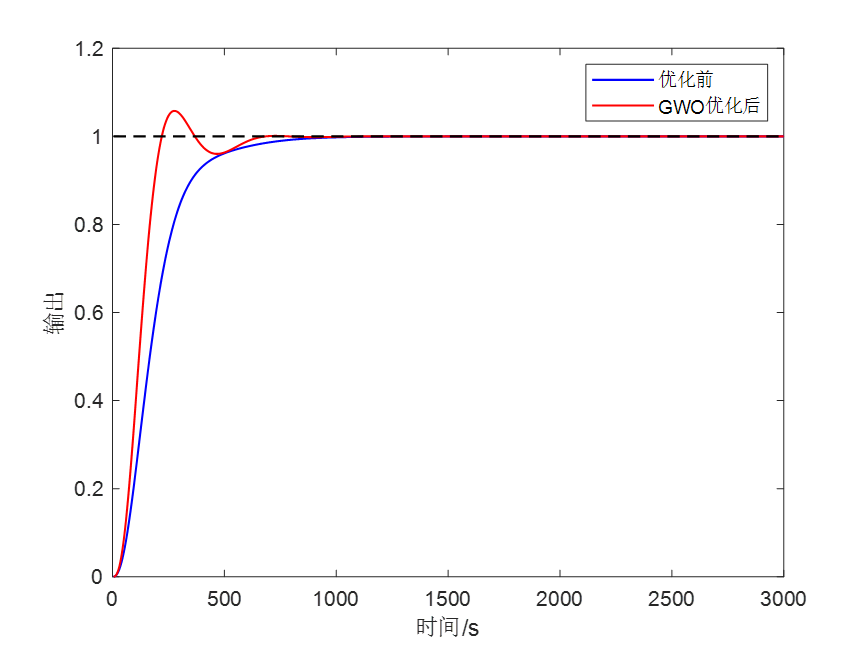
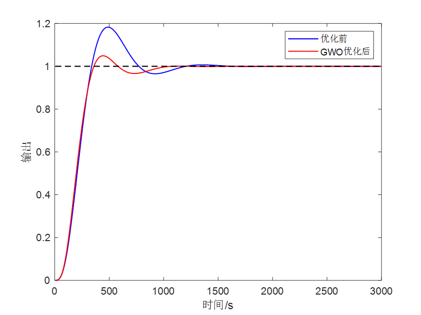
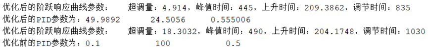
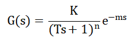
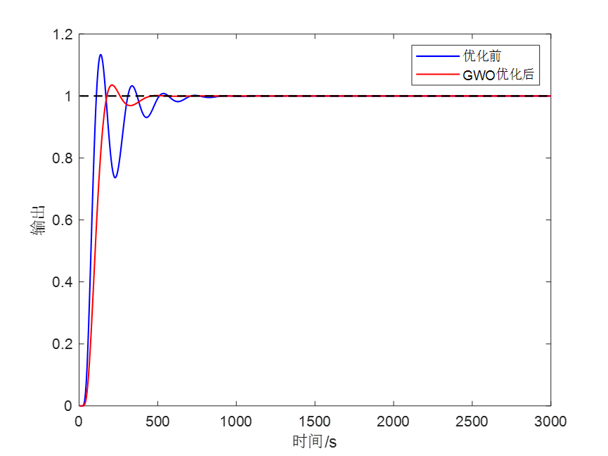
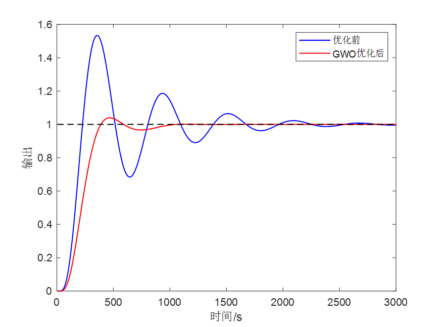
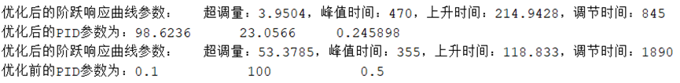

# Tuning PID parameters using Gray Wolf Algorithm, and the transfer function can be modified at will, with MATLAB code attached.

The code to run GWOPID.m is provided below:

Today's theme is: Using the Gray Wolf Optimization algorithm to tune various common transfer function PID parameters. There are many methods for tuning PID parameters, including orthogonal experimental design, pole placement method, and another category of intelligent optimization algorithms, such as genetic algorithms, particle swarm optimization, and neural network algorithms. Today, we will introduce a session on using the Gray Wolf Optimization algorithm to tune PID parameters and compare the time-domain indicators before and after tuning.

The transfer function includes five types, which essentially cover all common transfer functions.

The results of tuning PID using the Gray Wolf Optimization algorithm under step response are shown below:

01

Before and after GWO optimization:

02

Before and after GWO optimization:

03

Before and after GWO optimization:

04

Before and after GWO optimization:

05

Before and after GWO optimization:

Code:

## Images

<!-- PAYMENT_BLOCK -->

## Get this dataset

- Payment link (Stripe): [Buy now](https://buy.stripe.com/3cs8yP7sY87d0vu9AB)
- Payment QR code: 

<!-- /PAYMENT_BLOCK -->
